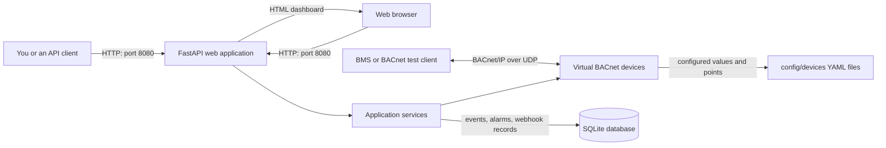
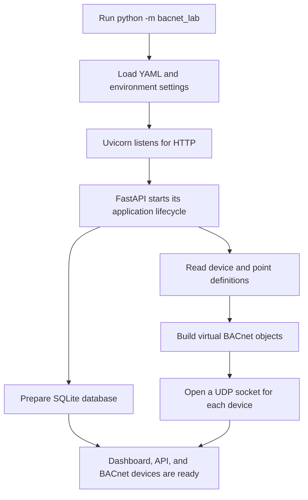
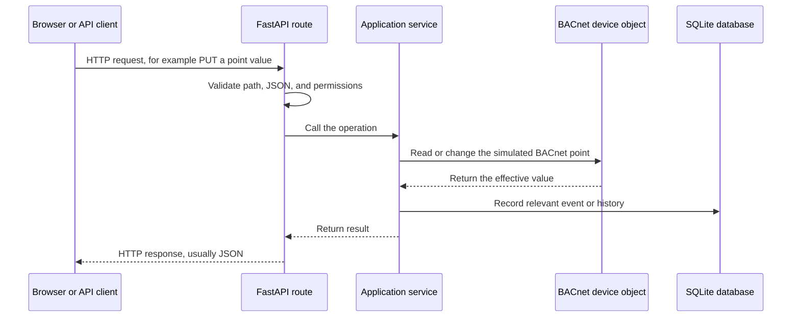
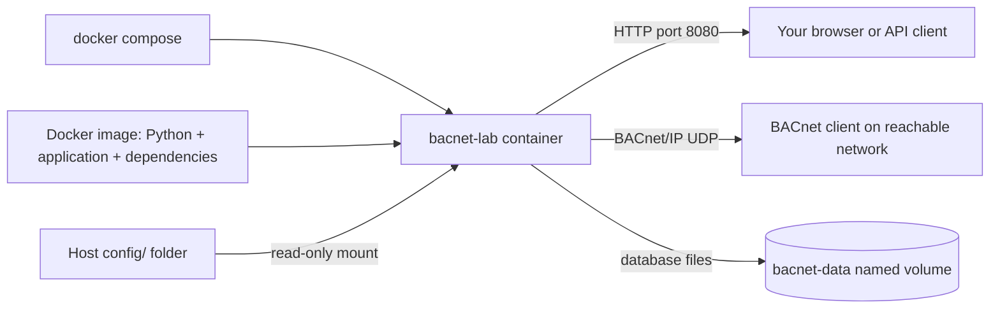

# BACnet Simulator: A Beginner's Guide

This guide explains the main pieces of BACnet Simulator and how they work together. It is for readers who are new to networking, APIs, FastAPI, and Docker.

## The short version

BACnet Simulator runs virtual HVAC equipment on your computer. Each virtual device exposes points such as temperatures, fan commands, and valve positions using BACnet/IP. You can also inspect and control the simulator through a web dashboard or a REST API.

There are two different kinds of network traffic:

- **HTTP** carries dashboard pages and API requests, usually through port `8080`.
- **BACnet/IP** carries building-automation messages over UDP, usually through ports `47808` and above.

The dashboard/API is not a BACnet client. It is a second way to manage the same simulated devices.

## How the pieces fit together



The YAML files describe what devices and points exist when the application starts. The application creates BACnet objects for them. The SQLite database is used for stored integration information such as events, alarms, webhook registrations, and deliveries; it is not the source of the device inventory.

## What happens at startup

When you run `python -m bacnet_lab`, Python calls the project's entry point. It loads settings, starts Uvicorn (the web server), and creates the FastAPI application. During FastAPI's startup lifecycle, the application prepares its services, loads the YAML devices, opens their BACnet/IP sockets, and starts background work such as value synchronization and event handling.



The application is intentionally run with **one worker**. A worker is a separate application process; multiple workers would each try to own their own devices and sockets. When the application stops, its lifecycle shuts down scenarios and background tasks and closes the device sockets.

## Networking in plain language

### HTTP: dashboard and REST API

HTTP is the request-and-response protocol used by websites. This project serves its dashboard and API from the same web application, normally on port `8080`.

Examples:

- `http://localhost:8080/ui` opens the dashboard.
- `http://localhost:8080/docs` opens FastAPI's interactive API documentation.
- `http://localhost:8080/api/devices` asks for the device list.

`localhost` means “this same computer.” The HTTP port does not carry BACnet messages.

### BACnet/IP: virtual building devices

BACnet/IP is the building-automation protocol. Here it is carried inside UDP network packets. A BACnet client talks directly to a device's IP address and UDP port; it does not call the REST API first.

By default, the simulator gives its devices ports starting at `47808`. With the included configuration, AHU-01 is on `47808`, CO2-01 on `47809`, and the remaining devices use the next ports. A UDP port is like a numbered doorway on an IP address: the address identifies the computer or interface, and the port identifies a particular BACnet application on it.

BACnet discovery uses a message called **Who-Is**. A broadcast is a message sent to devices on a local network segment. Routers generally do not forward broadcasts to other networks, and in this project each default device listens on its own UDP port. For that reason, a broadcast to one port will not automatically discover all the other default devices; send directed Who-Is requests to the configured addresses/ports. See [network configuration](configuration.md#network-topology) before connecting from another computer.

Keep BACnet UDP traffic on a trusted private network or VPN. HTTP authentication does not protect BACnet traffic.

## What is FastAPI doing?

FastAPI is the Python web framework that receives HTTP requests, checks their inputs, and sends responses. Uvicorn is the server process that listens on the network and passes HTTP requests to FastAPI.

For example, this request asks the API for the device inventory:

```http
GET /api/devices
```

The route calls the application service, which gets the current device information and returns it as JSON. JSON is a text format for structured data, so a response can contain device IDs, names, BACnet addresses, and point counts.

The API also has routes that change state. For example, a `PUT` request can command a point:

```http
PUT /api/devices/1001/points
Content-Type: application/json

{"point_name":"AHU-01/CoolingValve","value":80,"priority":16}
```

The API validates the request, then asks the device service to write the value to the simulated BACnet object. The response reports the **effective value**, which may differ from the requested value if another BACnet priority currently wins.



Not every request writes to SQLite. For example, the database stores history and webhook-related records, while the live BACnet objects own their current values and command priorities.

## BACnet points and priorities

A **device** represents equipment such as an air handler. A **point** represents one value or command on that equipment, such as a supply-air temperature or cooling-valve position. The YAML definition names each point, gives it a BACnet object type and instance, and sets its initial value.

Some points are commandable and have a BACnet priority array. Priorities range from 1 (highest) to 16 (lowest); the highest-priority active command determines the effective value. A write at priority 16 can therefore be accepted while a higher-priority command still controls the point. Sending `null` to a commandable point releases that priority slot.

Scenarios are built-in programs that change simulated values over time. For example, a day/night scenario can adjust HVAC-related points, and an alarm scenario can create test events. Scenarios use the same application services as API operations rather than acting as separate devices.

## What Docker adds

Docker packages the application and its Python dependencies into an **image**. Running that image creates a **container**, an isolated process with the files and settings it needs. Docker Compose reads `docker-compose.yml` and tells Docker how to build and run the container, connect its network, and attach storage.



The included Compose setup:

- Builds the image from the `Dockerfile` and starts one `bacnet-lab` service.
- Mounts the host's `config/` directory into the container read-only, so you can edit device configuration outside the container.
- Stores the SQLite database in the named `bacnet-data` volume. The volume survives normal container recreation and `docker compose down`.
- Uses host networking in the base Compose file on Linux, which lets BACnet use the host's network interfaces. The development override uses bridge networking and publishes the web UI on host loopback. That override is suitable for API/UI work, but it does **not** provide LAN BACnet broadcast connectivity, including the documented Windows/macOS Docker workflow.

Start the app with:

```bash
docker compose up -d --build
```

Useful commands:

```bash
docker compose ps                 # Show service status
docker compose logs -f bacnet-lab # Follow application logs
docker compose down               # Stop and remove the container/network
```

`docker compose down -v` also deletes the named database volume and its stored data. Use that only when you really intend to erase it.

## Try it yourself

Start locally with Python and `uv`:

```bash
uv sync --frozen --extra dev
uv run python -m bacnet_lab
```

Or use Docker on Linux:

```bash
docker compose up -d --build
```

Then open `http://localhost:8080/ui` or `http://localhost:8080/docs`. In the API docs, try `GET /api/health` and `GET /api/devices`. These are read-only requests, so they are a gentle first look at how an HTTP client interacts with the running application.

For a write example, API reference, network setup, and complete configuration options, continue with [REST API](api.md), [configuration](configuration.md), and [getting started](getting-started.md).

## A few terms

| Term | Meaning here |
|---|---|
| API | A defined way for another program to ask the simulator for data or request an action |
| Endpoint / route | A URL and HTTP method handled by the API, such as `GET /api/devices` |
| FastAPI | The Python framework that defines and runs the HTTP API |
| Uvicorn | The server that listens for HTTP traffic and runs the FastAPI app |
| BACnet/IP | Building-automation messages carried over an IP network |
| UDP port | A numbered network endpoint used by an application; the simulator assigns a port to each default device |
| Docker image | The packaged application template used to create containers |
| Container | The running application process created from an image |
| Docker Compose | A tool that configures and starts the application's container, network, and volume |
| Volume | Docker-managed storage that remains after a container is removed |